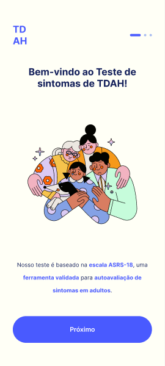
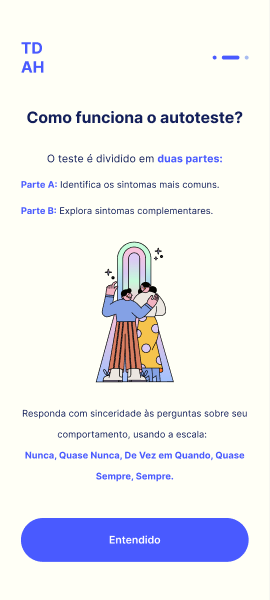
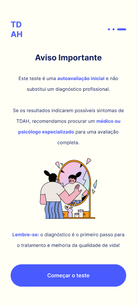
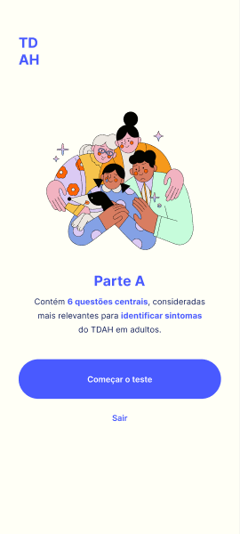
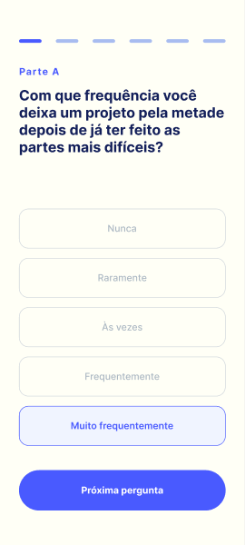
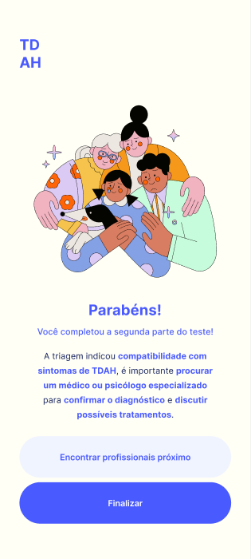
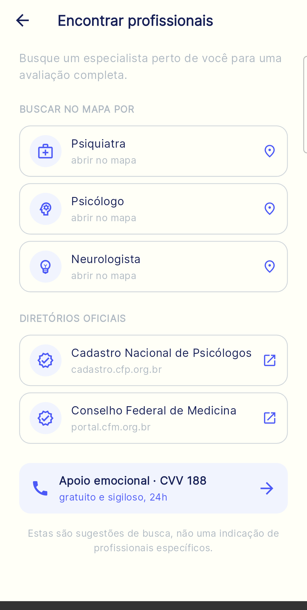

# TDAH Teste — Autoavaliação ASRS-18

> Aplicativo mobile em **Flutter** que digitaliza a escala **ASRS-18** (Adult ADHD Self-Report Scale) de autoavaliação de sintomas de TDAH em adultos, com um fluxo de cartões guiado e cálculo automático da triagem.

---

## Sumário

- [Sobre o Projeto](#sobre-o-projeto)
- [Aviso Importante](#aviso-importante)
- [Funcionalidades](#funcionalidades)
- [Capturas de Tela](#capturas-de-tela)
- [Como Funciona a Pontuação](#como-funciona-a-pontuação)
- [Tecnologias](#tecnologias)
- [Arquitetura](#arquitetura)
- [Pré-requisitos](#pré-requisitos)
- [Instalação e Configuração](#instalação-e-configuração)
- [Como Executar](#como-executar)
- [Como Fazer o Build](#como-fazer-o-build)
- [Estrutura do Projeto](#estrutura-do-projeto)
- [Roadmap](#roadmap)
- [Referências](#referências)

---

## Sobre o Projeto

O **TDAH Teste** é um aplicativo mobile desenvolvido em **Flutter** que automatiza um teste que antes era feito manualmente, seguindo o passo a passo de um PDF. Ele implementa a **escala ASRS-18 (ASRS-v1.1)**, desenvolvida com a Organização Mundial da Saúde (OMS), transformando o questionário em papel em uma experiência interativa de cartões deslizáveis.

O usuário passa por uma introdução, responde às 18 perguntas (6 da Parte A e 12 da Parte B) selecionando a frequência de cada sintoma, e ao final recebe o resultado da triagem com uma orientação clara sobre os próximos passos.

A interface é fiel a um protótipo de design (Material 3, fonte Inter, ilustrações e paleta próprias).

---

## Aviso Importante

> ⚠️ Este aplicativo **não é uma ferramenta de diagnóstico**. O ASRS-18 é apenas um **ponto de partida** para o levantamento de possíveis sintomas e avalia somente o critério A do TDAH. O diagnóstico correto só pode ser feito por um profissional de saúde qualificado (psiquiatra, neurologista ou psicólogo), por meio de uma avaliação clínica completa. As respostas ficam armazenadas apenas no aparelho do usuário.

---

## Funcionalidades

### Introdução (Onboarding)
- Três telas deslizáveis explicando o teste, como ele funciona (Parte A e B) e o aviso sobre o caráter não diagnóstico
- Indicador de progresso do onboarding

### Questionário
- Fluxo em cartões: uma pergunta por tela, navegável por **deslize** e por botão
- Barra de progresso segmentada por parte (6 segmentos na Parte A, 12 na Parte B)
- Escala de 5 opções: *Nunca, Raramente, Às vezes, Frequentemente, Muito frequentemente*
- Tela de intro da Parte A e tela de transição entre as partes

### Resultado
- Cálculo automático da triagem da **Parte A** (regra oficial da escala)
- Mensagem de resultado **condicional** — o texto muda conforme a triagem indica ou não compatibilidade com sintomas de TDAH
- Orientação para procurar avaliação profissional
- **Encontrar profissionais** — busca no mapa por especialidade (psiquiatra, psicólogo, neurologista), links para diretórios oficiais (CFP/CFM) e contato de apoio emocional (CVV 188)
- **Compartilhar o resultado** — ícone que abre a folha de compartilhamento do sistema com uma mensagem pronta (condicional à triagem, com aviso de que não é diagnóstico)

---

## Capturas de Tela

| Bem-vindo | Como Funciona |
|:---:|:---:|
|  |  |

| Aviso Importante | Introdução da Parte A |
|:---:|:---:|
|  |  |

| Cartão de Pergunta | Resultado |
|:---:|:---:|
|  |  |

| Encontrar Profissionais | |
|:---:|:---:|
|  | |

---

## Como Funciona a Pontuação

A pontuação segue fielmente a regra da escala ASRS-18:

- A **Parte A** (6 perguntas) é o **rastreio principal**. Cada pergunta tem uma "área sombreada" (as respostas de maior indicativo).
  - Perguntas 1 a 3: contam a partir de *"Às vezes"*.
  - Perguntas 4 a 6: contam a partir de *"Frequentemente"*.
- Se **4 ou mais** das 6 respostas caírem na área sombreada, os sintomas são considerados **altamente compatíveis** com TDAH e o app recomenda uma investigação profissional.
- A **Parte B** (12 perguntas) é **complementar/informativa** (sem pontuação mínima), servindo para aprofundar o levantamento e o detalhamento entre sintomas de **desatenção** e **hiperatividade/impulsividade**.

---

## Tecnologias

| Categoria | Tecnologia |
|---|---|
| Framework | [Flutter](https://flutter.dev) 3.27.0 |
| Linguagem | [Dart](https://dart.dev) 3.6.0 |
| Design | Material 3 |
| Tipografia | [google_fonts](https://pub.dev/packages/google_fonts) (Inter) |
| Estado / Injeção de dependência | [provider](https://pub.dev/packages/provider) |
| Navegação | [go_router](https://pub.dev/packages/go_router) |
| Persistência local | [shared_preferences](https://pub.dev/packages/shared_preferences) |
| Links externos (mapa/site/telefone) | [url_launcher](https://pub.dev/packages/url_launcher) |
| Compartilhamento | [share_plus](https://pub.dev/packages/share_plus) |
| Ícones | [cupertino_icons](https://pub.dev/packages/cupertino_icons) |
| Lints | [flutter_lints](https://pub.dev/packages/flutter_lints) |
| Testes | flutter_test |
| Gerência de versão | [FVM](https://fvm.app) (opcional) |
| Plataformas | Android · iOS · Web |

---

## Arquitetura

O app segue o padrão **MVVM enxuto** recomendado pela documentação oficial do Flutter para apps pequenos, com organização **feature-first** e separação entre a camada de UI e a de dados:

```
lib/
├── ui/
│   ├── core/                 # Tema e componentes compartilhados
│   │   ├── theme/
│   │   └── widgets/
│   ├── onboarding/           # View do onboarding
│   └── quiz/
│       ├── view/             # Views (intro, quiz, transição, resultado)
│       └── view_model/       # QuizViewModel (ChangeNotifier)
├── data/
│   ├── models/               # Question, QuizResult
│   ├── repositories/         # QuestionRepository (fonte da verdade)
│   └── asrs_questions.dart   # Dados das 18 perguntas
├── routing/                  # GoRouter (rotas do fluxo)
└── main.dart                 # Injeção de dependência (provider)
```

- **View** (widgets) apenas exibe o estado e captura interações.
- **ViewModel** (`QuizViewModel`, um `ChangeNotifier`) mantém as respostas e o estado derivado (rastreio, resultado) e expõe *commands* (`selectAnswer`, `reset`).
- **Repository** (`QuestionRepository`) abstrai a fonte das perguntas.
- O estado é compartilhado entre as telas via [`provider`](https://pub.dev/packages/provider), e o fluxo de dados é **unidirecional** (dados → UI; interações → ViewModel).
- A navegação é **declarativa** com [`go_router`](https://pub.dev/packages/go_router): as rotas ficam centralizadas em `routing/`, as telas não se importam entre si e a versão web ganha URLs reais por tela.

---

## Pré-requisitos

- [Flutter](https://docs.flutter.dev/get-started/install) 3.27.0 ou superior (Dart 3.6+)
- Android SDK (para build Android) e/ou Xcode (para build iOS)
- Um emulador ou dispositivo físico
- Opcional: [FVM](https://fvm.app) para fixar a versão do Flutter

---

## Instalação e Configuração

**1. Clone o repositório**

```bash
git clone https://github.com/victorlimabr/tdah-teste.git
cd tdah-teste
```

**2. Instale as dependências**

```bash
flutter pub get
```

---

## Como Executar

Liste os dispositivos disponíveis e rode:

```bash
flutter devices
flutter run
```

Para rodar em um dispositivo específico (ex.: no navegador):

```bash
flutter run -d chrome
```

Para rodar os testes:

```bash
flutter test
```

---

## Como Fazer o Build

**Android (APK):**

```bash
flutter build apk --release
```

O APK fica em `build/app/outputs/flutter-apk/app-release.apk`.

**Web:**

```bash
flutter build web --release
```

Os arquivos de saída ficam em `build/web/`.

---

## Estrutura do Projeto

```
tdah-teste/
├── assets/
│   └── images/                    # Ilustrações do app
├── docs/
│   └── screenshots/               # Capturas de tela usadas no README
├── lib/
│   ├── data/
│   │   ├── asrs_questions.dart      # As 18 perguntas do ASRS-18
│   │   ├── models/
│   │   │   ├── question.dart        # Modelo de pergunta (com área sombreada)
│   │   │   ├── quiz_result.dart     # Cálculo do resultado da triagem
│   │   │   └── quiz_progress.dart   # Snapshot do progresso (retomar)
│   │   └── repositories/
│   │       ├── question_repository.dart       # Fonte da verdade das perguntas
│   │       └── quiz_progress_repository.dart   # Progresso salvo (shared_preferences)
│   ├── ui/
│   │   ├── core/
│   │   │   ├── theme/app_theme.dart      # Cores e tema Material 3
│   │   │   └── widgets/                  # Logo, botões, indicadores, textos
│   │   ├── onboarding/
│   │   │   └── onboarding_screen.dart    # Introdução em 3 telas
│   │   └── quiz/
│   │       ├── view/                     # intro, quiz, transição, resultado
│   │       └── view_model/
│   │           └── quiz_view_model.dart  # Estado do teste (MVVM)
│   ├── routing/
│   │   ├── app_router.dart               # Configuração do GoRouter
│   │   └── routes.dart                   # Caminhos das rotas
│   └── main.dart                         # DI (provider) + MaterialApp.router
├── test/
│   ├── quiz_view_model_test.dart   # Testes de unidade do ViewModel
│   └── widget_test.dart            # Testes de widget e da pontuação
├── android/  ·  ios/  ·  web/       # Configurações por plataforma
├── pubspec.yaml
└── README.md
```

---

## Roadmap

Estado atual da arquitetura e próximos passos planejados:

**Já implementado**
- ✅ Fluxo completo do teste (onboarding → Parte A → transição → Parte B → resultado)
- ✅ Arquitetura **MVVM** (View + ViewModel + Repository)
- ✅ Estado com **provider** e navegação declarativa com **go_router**
- ✅ **Persistência das respostas** com [`shared_preferences`](https://pub.dev/packages/shared_preferences) — o progresso é salvo automaticamente e a tela inicial mostra um banner **"Continuar de onde parei"** que retoma o teste no cartão exato
- ✅ **Compartilhar o resultado** (texto) com [`share_plus`](https://pub.dev/packages/share_plus) — ícone na tela de resultado que abre a folha de compartilhamento do sistema com uma mensagem pronta
- ✅ Testes de unidade e de widget

**Planejado**
- ⏳ **CI (GitHub Actions)** — rodar `flutter analyze` + `flutter test` a cada Pull Request.
- ⏳ **Guard de rota** — impedir o acesso direto ao resultado sem responder o teste.
- ⏳ **Compartilhar como imagem** — gerar um card de resultado e compartilhá-lo como imagem (v2).

---

## Referências

- **ASRS-v1.1 / ASRS-18** — desenvolvido pela Organização Mundial da Saúde (OMS) com o grupo de pesquisadores liderado por Lenard Adler (NYU), Ronald C. Kessler (Harvard) e Thomas Spencer (Harvard).
- American Psychiatric Association. *Diagnostic and Statistical Manual of Mental Disorders* (DSM-IV-TR). Washington, DC, 2000.
- Fonte do questionário: [Harvard NCS — 18Q ASRS](https://www.hcp.med.harvard.edu/ncs/ftpdir/adhd/18Q_ASRS_English.pdf) · [tdah.org.br](https://tdah.org.br)
